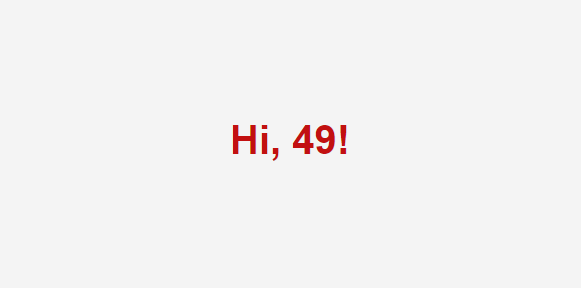
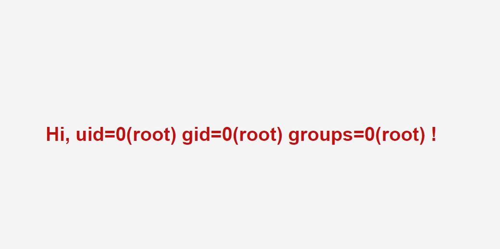
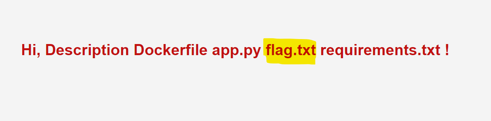
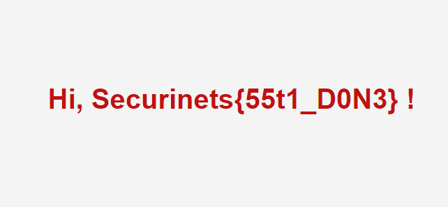

# SecuriNets ISI Friendly CTF 2023-2024

Three web challenges from the Securinets ISI Friendly CTF (2023-2024), written up while I was a member of Securinets, with the fix a developer should ship at the end.

- [Server Side Template Injection](#server-side-template-injection)
- [Local file inclusion 0 (LFI0)](#local-file-inclusion-lfi0)
- [Local file inclusion 1 (LFI1)](#local-file-inclusion-lfi1)

## Server Side Template Injection

### Confirmation of Jinja2 Usage

The title of this challenge, "Server Side Template Injection," coupled with the description, strongly suggests the use of the Jinja2 template engine in the web application. The mention of a Python web framework aligns with the fact that Jinja2 is commonly employed in Python web development.

### Supporting Argument

1. **Title Significance:** The inclusion of "Template Injection" in the title implies a vulnerability related to the rendering of templates on the server side. Jinja2 is a popular template engine in Python, making it a plausible choice for the web app's backend.

2. **Python Web Framework Hint:** The description hints at the web app being built with a Python framework. Considering Jinja2 is commonly used with frameworks like Flask and Django, it strengthens the case for Jinja2 being the template engine in play.

### Basic Jinja2 Injection Examples

The quickest probe is an arithmetic expression: if `{{7*7}}` comes back as `49`, the input is being rendered by the template engine instead of printed as text.

#### Exploit Test

1. **Test Payload:** Jinja2 - Basic Injection Test.


   *Description: `{{7*7}}`*

2. **Test Result:** The application responds with the output of the '{{7*7}}' command.



### SSTI Exploit for Remote Code Execution (RCE)

After confirming the presence of SSTI in the web application, the next step is to exploit it for Remote Code Execution (RCE). One common payload for achieving RCE in Jinja2 is as follows:

```jinja
{{ self.__init__.__globals__.__builtins__.__import__('os').popen('id').read() }}
```

1. **Test Payload:** Exploit the SSTI by calling os.popen().read().

   

2. **Test Result:** The application responds with the output of the 'id' command.

   

   *Description: Confirm that the application responds with the output of the 'id' command, indicating successful SSTI execution.*

3. **Directory Listing**

   - **Payload:** Modify the payload to list the contents of the current directory using `ls`.

   

   - **Test Result:** Execute the payload and observe the result to see the files and directories in the current location.

   

4. **Read Flag Contents**
   - **Payload:** Modify the payload to cat the contents of `flag.txt`.

     ```jinja
     {{ self.__init__.__globals__.__builtins__.__import__('os').popen('cat flag.txt').read() }}
     ```

   

   - **Test Result:** Execute the payload and observe the result to read the contents of the `flag.txt` file: `Securinets{55t1_D0N3}`.

   

## Local File Inclusion (LFI0)

### Confirmation of Local File Inclusion

 Confirmation of Local File Inclusion (LFI) is a crucial step in identifying and fixing vulnerabilities in web applications that use PHP. In LFI, attackers exploit improper input validation to include unauthorized files. To confirm LFI, they might use traversal sequences like "../" or null bytes (%00) to navigate directories or terminate file paths. This helps them gather information about the server environment and potentially execute malicious code. Prevention involves robust input validation, file path whitelisting, and regular software updates. Addressing LFI promptly is essential for maintaining web application security.

### Supporting Argument

Consider a PHP script that includes a file based on user input. If proper sanitization is not in place, an attacker could manipulate the page parameter to include local or remote files, leading to unauthorized access or code execution.

1. **Identify Vulnerable Script:**

   ```php
   <?php
   $file = $_GET['page'];
   include($file);
   ?>
   ```

2. **Exploit Directory Traversal:** The classic check is to include **/etc/passwd**, which exists on every Linux host.

   ```plaintext
   http://example.com/index.php?page=../../../etc/passwd
   ```

3. **include 'flag.txt' File:** Once I successfully traverse directories, I can include the flag.txt file.

   ```plaintext
   http://example.com/index.php?page=../../../../flag.txt
   ```

4. **Explanation :**

   - **../**: Move up one directory level.
   - **page=../../../../flag.txt**: Traverse up four levels to the root directory and include the flag.txt file.

5. **Result :** I've now successfully included the flag.txt file, allowing me to view its content or execute any malicious code it may contain.

## Local File Inclusion (LFI1)

### Introduction

Local File Inclusion (LFI) vulnerabilities can be exploited when user input is not properly sanitized, allowing attackers to include unauthorized files. In cases where filters are implemented to block certain traversal sequences like `"../"` attackers can attempt to bypass these filters using alternative techniques. Here the filter strips `"../"` in a single pass, and a nested sequence such as `"....//"` survives it.

### Supporting Argument

Consider a PHP script that includes a file based on user input. A common security measure is to use `preg_replace` to filter out `"../"` from the user input, intending to prevent directory traversal.

```php
<?php
$file = $_GET['page'];
// Filter out '../' to prevent directory traversal
$file = preg_replace('/\.\.\//', '', $file);
include($file);
?>
```

### Bypassing the Filter

1. **Exploiting with "....//"**: If the filter is specifically looking for `"../"` an attacker can use variations like `"....//"` to bypass the filter.

   ```plaintext
   http://example.com/index.php?page=....//....//....//....//flag.txt
   ```

2. **Why it works:** `preg_replace` scans the string once. In `....//` the middle `../` is removed, and the characters left on each side join into a new `../` that is never re-checked.

3. **Why `%2f` does not help here:** PHP URL-decodes `$_GET` before the filter runs, so `..%2f` reaches `preg_replace` as `../` and is stripped like the plain version. Encoding tricks only work when the application decodes the input a second time after filtering.

4. **Result**: The nested sequence restores the traversal, and the page includes `flag.txt` from outside the intended directory.

## The fix (both LFI challenges)

Stripping characters is not a fix. Map the parameter to an allowlist instead, so user input never becomes a path:

```php
<?php
$pages = ['home' => 'home.php', 'about' => 'about.php'];
$page  = $_GET['page'] ?? 'home';
include __DIR__ . '/pages/' . ($pages[$page] ?? 'home.php');
?>
```

If the file names have to be dynamic, resolve the path with `realpath()` and refuse anything that does not start with the pages directory. For the SSTI challenge, the fix is to pass user input to the template as data (`render_template('page.html', name=name)`) and never build the template string from it.
